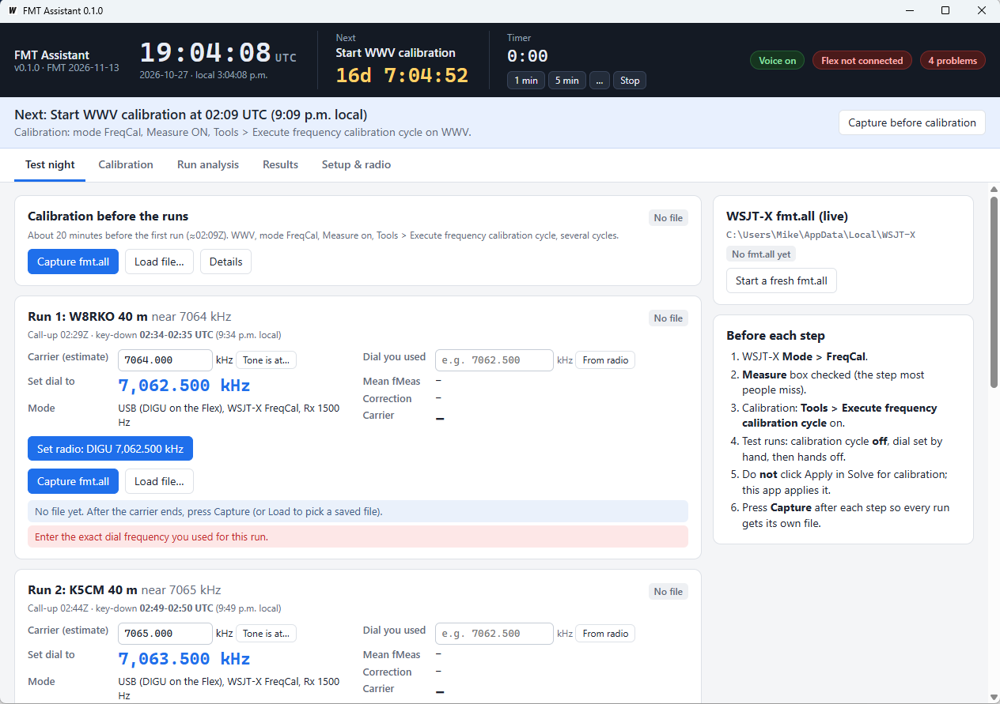

# FMT Assistant

**A Windows companion for the ARRL Frequency Measuring Test (FMT), using WSJT-X FreqCal.**

With your regular HF radio, you too can achieve amazing accuracy in the ARRL
Frequency Measuring Test. Calibrate your radio against WWV first, then measure each
carrier with the FreqCal mode of WSJT-X, and you can likely get within 1 Hz, often
much better. You already have all the equipment you need.

FMT Assistant sits beside WSJT-X on test night. It keeps the clock, tells you by
voice what to do and when, checks the measurement files WSJT-X writes for the usual
mistakes, and works out each carrier frequency, ready to submit.



## TL;DR

**What you get:** each FMT carrier's frequency, corrected for your radio's error,
with the slips that usually cost points (wrong dial, wrong file, calibration left on
in WSJT-X) caught before you submit. With a GPS-locked radio expect a few hundredths
of a hertz on a quiet night; with an ordinary radio calibrated on WWV, about a tenth;
see [How accurate is it?](#how-accurate-is-it).

The app's tabs are numbered in the order you use them: **1 Setup & radio**,
**2 Practice**, **3 Test night**, **4 Results**. *Calibration* and *Run analysis*
are detail views you open when you want to look closer.

**Step 1, Setup (once, a few days before):**

1. Download `FMTAssistant.exe` from [Releases](../../releases) and run it. No installer.
2. In WSJT-X: **Mode > FreqCal**, WWV frequencies in the FreqCal list, and
   **Settings > Frequencies** calibration intercept and slope both **0**.
3. In FMT Assistant, **1 Setup & radio**: callsign, the WSJT-X log folder, your
   frequency reference, and press **Test** for the voice.

**Step 2, Practice (at least once before the test):** on **2 Practice**, rehearse the
routine on a local AM station or WWV. It has its own optional calibration, so it never
touches the test-night files.

**Step 3, Test night** (the app says each step out loud; keep **3 Test night** open):

1. **About 20 minutes before the first run:** WSJT-X calibration cycle on WWV with
   **Measure** checked; stop it at the prompt and press **Capture**. (With a GPS-locked
   radio this is only a check: you'll use *No correction*.)
2. **Each of the four runs:** at call-up set USB to the dial shown, centre the tone
   near 1500 Hz, type the exact dial into **Dial you used**, then hands off. At
   key-down WSJT-X measures for a minute; then press **Capture**.
3. **After the last run:** calibrate on WWV again and **Capture**.

**Step 4, Results:** on **4 Results**, every run **Ready**, then enter each **Carrier
frequency** on the [ARRL FMT data entry page](https://fmt.arrl.org/fmtentry.php).
When the ARRL publishes the true frequencies, type them into **How close were you?**
on the same tab to see each error, and copy a ready-made prompt to talk it through
with an AI.

Print the [operator checklist](https://va3mw.github.io/FMTAssistant/checklist.html)
for the minute-by-minute version. The rest of this README explains each step.

---

## Contents

1. [What it does](#what-it-does)
2. [What you need](#what-you-need)
3. [Download and install](#download-and-install)
4. [How the measurement works](#how-the-measurement-works)
5. [Step 1: Set up (Setup & radio tab)](#step-1-set-up-setup--radio-tab)
   - [Frequency reference](#frequency-reference)
   - [FlexRadio control (optional)](#flexradio-control-optional)
6. [Step 2: Practice (Practice tab)](#step-2-practice-practice-tab)
7. [Step 3: Test night (Test night tab)](#step-3-test-night-test-night-tab)
8. [Step 4: Results and submitting (Results tab)](#step-4-results-and-submitting-results-tab)
   - [After the results are published](#after-the-results-are-published)
9. [The screens explained](#the-screens-explained)
   - [Setup & radio tab](#setup--radio-tab)
   - [Practice tab](#practice-tab)
   - [Test night tab](#test-night-tab)
   - [Results tab](#results-tab)
   - [Calibration tab](#calibration-tab)
   - [Run analysis tab](#run-analysis-tab)
   - [Live readings and the stability chart](#live-readings-and-the-stability-chart)
   - [About tab](#about-tab)
10. [Checks and warnings, and what to do about them](#checks-and-warnings-and-what-to-do-about-them)
11. [Files and folders](#files-and-folders)
12. [Using files you already have](#using-files-you-already-have)
13. [Troubleshooting](#troubleshooting)
14. [How the numbers are calculated](#how-the-numbers-are-calculated)
15. [How accurate is it?](#how-accurate-is-it)
16. [Building from source](#building-from-source)
17. [Credits](#credits)

---

## What it does

- **Clock and schedule.** It shows a large UTC clock, local time, and a countdown
  to the next event (calibration, call-up, key-down, key-up). There's also a
  1-minute, 5-minute or custom timer with sound.
- **Voice prompts and beeps.** It tells you when to start and stop calibration
  and when each call-up starts, with the exact dial to set. It warns you at two
  minutes and 30 seconds, counts down the last five seconds before key-down, and
  announces key-down, 30 seconds left, and the end of the carrier, with a reminder
  to capture the file.
- **Dial helper.** For each run it shows the carrier frequency and the dial to set
  (carrier − 1500 Hz). If the tone isn't near 1500 Hz on the waterfall, type in
  where it is and it works out a better dial.
- **File collection.** It keeps six files per test: calibration before, the four
  runs, and calibration after. One click (**Capture**) copies WSJT-X's `fmt.all`
  into the session and clears it for the next step, so files can't get mixed together.
- **Calibration.** It fits the straight line WSJT-X uses (intercept A, slope B)
  and drops weak readings (S/N under 20 dB, marked `*`) automatically. Stations
  other than WWV/WWVH, such as AM broadcasters, are left out unless you include them.
- **Run analysis.** It finds the one-minute key-down carrier in each run file and
  ignores CW identification and dead air. It also drops the readings at either
  end of the carrier and any wild values, then averages the rest.
- **Mistake checks.** It catches dial typos, the wrong file in a slot, the same
  file used twice, a calibration file used as a run, readings from another run's
  time slot, calibration left switched on inside WSJT-X, drift between the before
  and after calibrations, and more. See [Checks and warnings](#checks-and-warnings-and-what-to-do-about-them).
- **Practice tab.** It rehearses the full routine on your local AM broadcast station
  (or WWV) any evening, with the same prompts, Capture and analysis.
- **Live readings and stability chart.** While a step is on, it follows WSJT-X's
  `fmt.all` second by second and shows the number of good readings, the running
  mean, σ, drift, the uncertainty of the mean and a live carrier estimate, with a
  chart of every reading. It warns at once if readings stop, the tone is far from
  1500 Hz, or the readings jump. This is a preview; the answer still comes from
  Capture. See [Live readings and the stability chart](#live-readings-and-the-stability-chart).
- **Results.** It shows the four answers, saves a full report (`FMT results.txt`)
  and has a Copy button.
- **FlexRadio control (optional).** It finds your FlexRadio on the LAN and can set
  the slice to DIGU on the right dial, by button or automatically at each call-up.
  It never transmits. It's off by default, and everything else works with any radio.

## What you need

- **Just `FMTAssistant.exe`.** The whole program is that one file, with its screens
  built in: there's no installer, no runtime and nothing else to copy. FlexRadio
  control and the voice prompts need nothing extra either.
- Windows 10 or 11 (64-bit). The app uses Microsoft Edge WebView2, which comes with
  Windows 11 and is installed on almost every Windows 10 PC. If a PC doesn't have
  it, Windows offers to install it the first time you run the app.
- Windows SmartScreen may warn the first time you run it, because the exe isn't
  code-signed: click **More info**, then **Run anyway** (see
  [Download and install](#download-and-install)).
- An HF receiver with CAT control working in WSJT-X, and a working audio path into
  WSJT-X (sound card, USB codec or DAX).
- **WSJT-X 2.x or later**, which includes FreqCal mode. Tested with WSJT-X 3.0.
- A PC clock synchronised to internet time (Windows Settings > Time & language >
  Date & time > **Sync now**). The app's clock and schedule come from the PC clock.
- A radio that has been switched on and warmed up for several hours before the test.

## Download and install

1. Open the **[Releases](../../releases)** page of this repository.
2. Download **`FMTAssistant.exe`** from the latest release.
3. Save it anywhere you like, for example `C:\Ham\FMTAssistant\`. There's no
   installer; it's a single program file.
4. Double-click it to run.

> **Windows SmartScreen.** The program isn't code-signed, so the first time you run
> it Windows may say *"Windows protected your PC"*. Click **More info**, then
> **Run anyway**. If your antivirus quarantines it, allow it, or
> [build it yourself](#building-from-source) from the source here.

The first time it runs, FMT Assistant creates:

- `Documents\FMT Assistant\FMT 2026-11-13\`: the session folder for your files and report.
- `%APPDATA%\FMTAssistant\`: the app's own settings and a daily log file in `logs\`.

## How the measurement works

WSJT-X's **FreqCal** mode measures the exact audio frequency of a steady carrier.
With the radio in USB and the dial about 1500 Hz below the carrier, the carrier
comes out as an audio tone near 1500 Hz:

```
carrier frequency = dial frequency + measured tone (fMeas)
```

No radio is perfect, so you first measure stations whose frequency is known
exactly (WWV on 2.5, 5, 10, 15 and 20 MHz). A perfect radio would read exactly
1500 Hz; the difference is your radio's error. Measuring several WWV frequencies
gives a straight line:

```
error (Hz) = A + B × f        A = intercept in Hz, B = slope in ppm, f in MHz
```

The final answer subtracts that error:

```
carrier frequency = dial + mean fMeas − (A + B × f)
```

FMT Assistant does all of this arithmetic. Your jobs are to run WSJT-X, set the
dial, write down (type in) the exact dial you used, and press **Capture** after
each step.

## Step 1: Set up (Setup & radio tab)

Do this a few days before the test.

### WSJT-X

1. **Mode > FreqCal.**
2. **File > Settings > Frequencies.** In the *Working Frequencies* table, click the
   **Mode** column header to sort by mode and find the FreqCal entries. Keep only
   stations you can hear reliably; in North America that usually means WWV
   2.5, 5, 10, 15 and 20 MHz. Right-click to delete or add entries.

   **Adding the WWV frequencies.** If your list doesn't already have them, add
   2.5, 5, 10 and 15 MHz (and 20 MHz if you hear it). Right-click the table and
   choose **Insert**, set **Mode** to **FreqCal**, type the station frequency in
   MHz (for example `5.000`), and click **OK**. Repeat for each frequency, then
   click **OK** to close Settings. With **Mode > FreqCal** selected, those entries
   appear in the band list on the main window, and the calibration cycle steps
   through them by itself. Pick one by hand and check that the dial lands 1.5 kHz
   below the station (4998.500 kHz for WWV 5 MHz), so the carrier shows up near
   1500 Hz on the waterfall.

   **Or tune by hand.** You don't have to use the list at all. With **Measure**
   checked and the calibration cycle off, set the radio to USB and tune exactly
   1500 Hz below each WWV carrier: **2498.500**, **4998.500**, **9998.500** and
   **14998.500 kHz**, with the WSJT-X Rx offset at 1500 Hz. Stay on each frequency
   for a few minutes so WSJT-X collects several readings. WSJT-X follows the dial
   through CAT and files the readings under the right station, and FMT Assistant
   uses them just like readings from the calibration cycle. The dial must be
   exactly on these settings: a calibration reading assumes the carrier sits
   precisely 1500 Hz above the dial, so a dial 10 Hz off becomes a 10 Hz error.
3. In the same Settings page, check **Frequency Calibration**:
   **Intercept = 0** and **Slope = 0**.
   - This matters. If WSJT-X has a calibration applied, it quietly moves the radio
     away from the dial it shows you, and the dial you type in will be wrong.
   - FMT Assistant reads WSJT-X's settings and shows a red warning if these aren't zero.
   - On test night, **never click Apply** after *Tools > Solve for calibration
     parameters*. FMT Assistant applies the correction itself.
4. Make sure you can find the **Measure** check box on the main window. It must be
   checked whenever you measure; without it, WSJT-X shows readings on screen but
   never writes them to `fmt.all`.
5. WSJT-X can't record the audio for you: in FreqCal mode it writes only `fmt.all`
   and no `.wav` files, even with **Save > Save all** on. If you want a recording,
   set up a separate recorder (see [Test night](#step-3-test-night-test-night-tab)).

### FMT Assistant

Open the **Setup & radio** tab. (Until you enter your callsign, the Test night tab
shows a *New here?* note with a button that takes you there.)

1. **Callsign.** Enter it; it goes on the report.
2. **WSJT-X log folder.** This is where WSJT-X writes `fmt.all`. Usually it's
   `C:\Users\<you>\AppData\Local\WSJT-X`, and the app picks it automatically.
   - To check: in WSJT-X choose **File > Open log directory** and compare the path.
   - If you run WSJT-X with a rig name (`--rig-name`), the folder is called
     `WSJT-X - <rig name>`. Choose it from the list, or use **Browse…**.
   - Under the folder, the app shows the calibration WSJT-X has in its settings.
     It should read *intercept 0 Hz, slope 0 ppm (good: zero)*.
3. **Schedule (UTC).** It's pre-filled with the November 13, 2026 test:

   | Run | Station | Near | Call-up (UTC) | Key-down (UTC) | Key-down (Eastern) |
   |---|---|---|---|---|---|
   | 1 | W8RKO 40 m | 7064 kHz | 0229 | 0234–0235 | 9:34 PM |
   | 2 | K5CM 40 m | 7065 kHz | 0244 | 0249–0250 | 9:49 PM |
   | 3 | W8RKO 80 m | 3598 kHz | 0259 | 0304–0305 | 10:04 PM |
   | 4 | K5CM 80 m | 3599 kHz | 0314 | 0319–0320 | 10:19 PM |

   For a future test, edit the station, band, nominal frequency (kHz) and key-down
   time (`YYYY-MM-DD HH:MM`, UTC), then press **Save** on that row. Call-up is
   always 5 minutes before key-down, and the carrier lasts 1 minute.
4. **Voice and sound.** Press **Test**. You should hear a beep and a spoken sentence.
   Adjust the volume, and switch voice or beeps off if you prefer. The **Voice on**
   button at the top right of the window switches voice prompts on and off quickly.
5. **Sessions.** Each test is a *session*, a folder holding its six files, your
   dial entries and the report. **New session…** starts a clean one (for the next
   FMT, for example) and keeps your schedule and settings. **Open session…** opens
   an earlier one.
6. **Frequency reference.** Tell the app what your radio's frequency comes from
   (see [Frequency reference](#frequency-reference) below). A connected FlexRadio
   reports its own, so Flex users can skip this.

### Frequency reference

Every radio's frequency comes from a reference oscillator, and that decides how
much calibrating it needs:

| Reference | What to choose | What it means for the test |
|---|---|---|
| The radio's own oscillator (TCXO or OCXO), the usual case | **Internal oscillator** | Typically a few hertz off on 40 m, and it drifts a little with temperature. Calibrate on WWV before and after, and keep **Average** selected. |
| An external 10 MHz of unknown accuracy (a lab generator, an older OCXO) | **External 10 MHz reference** | Treated like an internal oscillator: calibrate on WWV. |
| GPS-disciplined: a GPSDO or GNSS module in the radio, or an external GPS-locked or rubidium 10 MHz | **GPS-disciplined**, or tick **My external 10 MHz is GPS-disciplined or rubidium** | Its error is far below 0.01 Hz once locked, better than any WWV calibration. Choose **No correction** on the Calibration tab. A WWV calibration would add WWV's own path Doppler (several ppb), so use it only as a check. |

The reference never enters the arithmetic: the WWV calibration measures the
radio's whole error, whatever the reference. It decides which checks apply:

- **Each Capture records the reference** the radio was on while that file was
  measured. It's shown on the card and written in the report.
- **A calibration only holds for the reference it was made on.** If a run was
  measured on a different reference from the calibration used for it (for example
  the GPSDO dropped out and the radio fell back to its TCXO), the run gets an error.
- **If the reference changed during a run or a calibration**, that file gets an
  error: no single correction fits it.
- **No correction** is an error on a run measured on a TCXO or an unlocked GPSDO
  (read from a FlexRadio), and a warning if Setup says your reference isn't
  GPS-disciplined.
- **With a GPS-locked reference, don't apply a WWV correction.** If a run on a locked
  GPS reference is corrected with WWV, the app warns and shows how much the correction
  moved the answer; the Calibration tab recommends *No correction*.
- **With a GPS-locked reference, a WWV calibration is a check.** Within 0.03 Hz, the
  app says the whole chain checks out; between 0.03 and 0.3 Hz, it says that's WWV's
  path Doppler; beyond 0.3 Hz it warns, because that usually means WSJT-X's own
  calibration isn't zero or the radio isn't really on its GPSDO.

**FlexRadio users.** The app reads the radio's reference status: which reference is
selected and which is in use, whether it's locked, and whether a TCXO, GPSDO, GNSS
module or external reference is fitted. It shows this in the radio status at the top right of the
window (for example *GPSDO locked*, or *Ext 10 MHz lost!*) and in **Setup & radio**. It warns if the
GPSDO isn't locked yet, if the radio isn't locked to its external reference, or if
the reference you selected isn't the one in use (with *Auto*, the radio falls back to
its TCXO by itself). With an external 10 MHz, the radio can't tell how good the
signal is, so tick **My external 10 MHz is GPS-disciplined or rubidium** if it is.
If the radio has GPS, the app also compares its GPS time with the PC clock and warns
if they differ by 2 seconds or more.

The GPS *freq_error* a FlexRadio reports is shown, but not used in the answer: its
units and sign aren't documented, and a locked GPSDO's error is far below 0.01 Hz
anyway.

### FlexRadio control (optional)

Skip this section if you don't have a FlexRadio; the rest of the app works the same.

1. Make sure SmartSDR (or another GUI client) is running and connected to the radio.
2. In **Setup & radio**, tick **Use a FlexRadio on this network to set DIGU and the dial**.
   The first time, Windows Firewall may ask about network access. Allow it on
   private networks, because the app listens for the radio's discovery broadcasts
   on UDP port 4992.
3. Choose your radio from the list and press **Connect**. If it doesn't appear (for
   example, it's on a different subnet), type its IP address and press **Connect to IP**.
4. Choose the **SmartSDR station**, and the **slice** you'll use with WSJT-X.
5. Test it with the **Quick tune** buttons (for example **WWV 10**). The slice
   should change to DIGU with the dial 1500 Hz below the station.
6. Optional: tick **Tune automatically at each call-up**, so the radio moves to the
   suggested dial by itself as each call-up starts.

When the app sets the radio it switches the slice to **DIGU**, turns **RIT off** and
sets the **DIGU offset to 0**, so the frequency SmartSDR shows is the true dial.
It then asks the radio to confirm, and shows an error if something else changed it
back. The radio status at the top right of the window shows the radio, slice,
frequency and mode.

Warnings in the Flex panel tell you if the slice is not in DIGU, RIT is on, or a
DIGU offset is set.

## Step 2: Practice (Practice tab)

Practise the whole process at least once before the real test. Practice FMTs are
announced on the [fmt-nuts group](https://groups.io/g/fmt-nuts), but you don't
have to wait for one: the **Practice** tab lets you rehearse any evening on your
local AM broadcast station (or on WWV).

### Practice on an AM broadcast station

An AM broadcast station is an ideal practice target. It's strong day and night,
it's a steady carrier like the FMT key-down, and it sits on a round frequency: a
multiple of 10 kHz in the Americas (for example 1010 kHz), or 9 kHz in most other
regions. The Practice tab runs a one-minute "key-down" whenever you like, with
the same voice prompts, Capture and analysis as test night.

**What you need:** a receiver that covers the AM broadcast band (most HF
transceivers do, and so do all FlexRadio 6000 models), plus any antenna. The
signal is usually very strong. The app accepts frequencies from 500 kHz to 30 MHz.

**Steps:**

1. Open the **Practice** tab.
2. Optional: calibrate on WWV with the **Practice calibration** card, so the practice
   answer is corrected for your radio's error. In WSJT-X run the calibration cycle on
   WWV for a few cycles with **Measure** checked, then press **Capture** on that card.
   It's kept apart from the test-night calibrations, so rehearsing never touches them.
   The practice answer uses the practice calibration if there is one, otherwise the
   test-night calibration, otherwise none, and says which. With a GPS-locked reference,
   skip this and choose *No correction* on the Calibration tab.
3. Choose your carrier.
4. Type the station's frequency in **kHz**, for example `1010`. (For WWV, use the
   **WWV 5 / 10 / 15** buttons.)
5. Choose **Start measuring in** (1, 2 or 5 minutes; that's your call-up time).
   Leave **Start a fresh fmt.all** ticked: it moves the old `fmt.all` aside so
   earlier readings can't mix in. (This needs **Setup & radio** to point at the
   folder WSJT-X writes to; the WSJT-X panel on the Test night tab shows it.)
6. Press **Start practice**. The app says the dial to set and counts down. The
   banner and the **Next** countdown work exactly as on test night.
7. In WSJT-X: **Mode > FreqCal**, calibration cycle **off**, **Measure** on. Set
   **USB** (DIGU on a Flex) to the **Set dial to** value, for example
   **1,008.500 kHz** for a 1010 kHz station. Flex users can press **Set radio**.
8. Look at the WSJT-X waterfall. The carrier should be a strong steady line near
   1500 Hz, with the programme audio spread out above it. If the carrier isn't
   near 1500 Hz, press **Tone is at…** and retune to the new dial.
9. Type the exact dial into **Dial you used** (or press **From radio**), then keep
   your hands off the dial. The **Live readings** card shows the readings as they
   arrive, with a live answer and a chart; amber warnings there tell you at once if
   readings stop or the tone is far from 1500 Hz.
10. At one minute to go, 30 seconds, the 5-second countdown and "key down", the
    prompts are the same as on test night. Let WSJT-X measure for the whole minute.
11. When the voice says the minute is over, import the file yourself. Press
    **Capture fmt.all** to copy it from the WSJT-X folder, or **Load file…** to
    pick fmt.all by hand. Nothing is analysed until you do.
12. Read the **Result**: mean fMeas, correction, the carrier frequency, and
    **vs nominal**, how far it is from the station's published frequency. The
    readings chart and table appear below, just like on the Run analysis tab. Only
    the readings inside the measuring minute are used, and the first and last
    are dropped.
13. Press **Restart practice** to go again, with **Start a fresh fmt.all** still
    ticked. The previous practice file is kept, renamed, in the session folder.

**How to judge the result:**

- **AM broadcast stations aren't frequency standards.** Many are within a hertz or
  two of nominal, and some are GPS-locked, but the legal tolerance is ±20 Hz.
  VA3MW measured local carriers at +1.8, +0.8 and −0.5 Hz. A steady offset that
  repeats night after night belongs to the station, not to you. What you're
  practising is the routine, and steady readings (SD of a few tenths of a hertz).
- **WWV is exact at the transmitter**, so a calibrated radio should land within
  about 0.1 Hz, and a GPS-locked one within a few hundredths; what's left is mostly
  the path's Doppler. If you calibrated on the same WWV frequency you practise on, the
  check is circular and will look perfect; practise on a different WWV frequency.
- **Never use an AM station in your real calibration.** That's why the Calibration
  tab leaves stations that aren't WWV out unless you deliberately include them.

Practice results never appear on the Results tab, in the report, or in the
problem count.

### Check that FreqCal follows a hand-set dial

It's also worth proving once that FreqCal measures correctly at any dial you set
by hand:

1. Turn the calibration cycle **off**, leave **Measure** on, and tune WWV 5 MHz with
   the dial deliberately 50 Hz off, for example **4998.450 kHz** instead of 4998.500.
2. Confirm WSJT-X reads fMeas near **1550 Hz**.

You can do this on the Practice tab: press **WWV 5**, start a practice run, and
set the dial to 4998.450 instead of the suggested 4998.500. The answer should
still come out within a fraction of a hertz of 5,000,000.00 Hz.

## Step 3: Test night (Test night tab)

Have WSJT-X and FMT Assistant side by side. Keep the **Test night** tab open; the
banner under the clock always says what to do now and offers the button
you'll need.

**Print the [operator checklist](https://va3mw.github.io/FMTAssistant/checklist.html)**
(two pages: before the night, and minute by minute on the night, with a table to
write each dial down as a paper backup).

**Record the audio.** Recording the receiver audio for the whole evening lets you
go back to it later. WSJT-X can't do this for you: in FreqCal mode it writes only
`fmt.all` and doesn't save `.wav` files, even with **Save > Save all** on. Use a
separate recorder such as Audacity on the same audio input WSJT-X uses (DAX on a
Flex), start it before the calibration, and keep the file with your session folder.

**Every file is kept.** Each Capture or Load also saves a dated copy in the
session's `Archive` folder that is never overwritten (see
[Files and folders](#files-and-folders)).

### 1. Calibration before (about 0209Z, 20 minutes before the first run)

The voice says *"Twenty minutes to the first run. Start the before calibration…"*

1. In WSJT-X: **Mode > FreqCal**, check **Measure**, then **Tools > Execute frequency
   calibration cycle**. WSJT-X steps through its WWV list by itself.
2. In FMT Assistant, watch the **WSJT-X fmt.all (live)** panel on the right. It should
   say *Measuring* with a growing count of readings. If it stays at *No fmt.all yet*,
   the Measure box isn't checked or the log folder is wrong. The calibration card
   also shows a **Live preview**: one small chart per WWV station as WSJT-X steps
   through them, with the fit worked out as it goes. An amber warning means a
   station is far off or jumping.
   - If `fmt.all` has old readings from an earlier day, press **Start a fresh fmt.all**
     *before* you begin.
3. Let it run several full cycles.
4. At about 0225Z the voice says *"Four minutes to the first call-up. Stop the
   calibration cycle…"*. In WSJT-X, untick **Tools > Execute frequency calibration
   cycle** (or click **Stop**).
5. Press **Capture** on the **Calibration before the runs** card (or in the banner).
   The card should show **Ready**, with slope, intercept, number of stations and
   StdDev. A good result has a StdDev of a few tenths of a hertz or less.
6. If any station is weak or suspicious, open the **Calibration** tab and set it to
   **drop**. You need at least two WWV stations; three or more is better.

### 2. Each run (four times)

Each run has a 5-minute call-up (CW identification), then a **1-minute key-down
carrier**. The card for the current run is outlined in blue.

**At call-up** (the voice says the station and the dial):

1. In WSJT-X, make sure the calibration cycle is **off** and **Measure is on**.
2. Set the radio to **USB** (DIGU on a Flex) with the dial shown in big blue
   numbers, **Set dial to**, for example **7,062.500 kHz** for a carrier near
   7064 kHz.
   - Flex users: press **Set radio** (or let auto-tune do it).
3. Find the carrier on the WSJT-X waterfall. If it isn't near 1500 Hz, press
   **Tone is at…** on the run card and type the audio frequency where you see it.
   The app updates the *Carrier (estimate)* and the *Set dial to* value; retune to
   the new dial (Flex: press **Set radio** again).
   You can also type a better carrier estimate straight into *Carrier (estimate)*.

**Two minutes before key-down:** centre the tone near 1500 Hz, then **type the exact
dial frequency into "Dial you used"**. You can type it in kHz (`7062.500`), MHz
(`7.0625`) or Hz (`7062500`); the app shows how it read it. Flex users can press
**From radio** to copy it straight from the slice.

**30 seconds before key-down:** hands off the dial. Don't touch it until the carrier ends.

**Key-down** (beep, *"Key down. Measuring."*): the banner turns red and counts down
the minute. WSJT-X makes a reading about every six seconds. With FlexRadio control on,
the app also reads the slice's own tuning error (a few millihertz) at this moment and
adds it to the dial in the answer. The run card's **Live
preview** (it appears from call-up) shows the readings arriving, the running mean
and a live carrier, with a chart of every reading. You want readings arriving, a
steady chart and no amber warnings; see
[Live readings and the stability chart](#live-readings-and-the-stability-chart).
The live carrier is a preview: the answer comes from Capture.

**Carrier ends** (beep, *"Carrier ended. Press Capture…"*):

1. Press **Capture** on the run card (the banner offers it too). This copies the
   readings for this run and clears `fmt.all` for the next one.
2. Check the card. It should show **Mean fMeas**, **Correction**, the **Carrier**
   answer in green, and **Ready**. Read any message in red or amber; the
   [Checks and warnings](#checks-and-warnings-and-what-to-do-about-them) table says
   what each one means.
3. Optional: the **Readings** button opens the run's chart and table, so you can see
   which readings were used.

Repeat for all four runs.

### 3. Calibration after (about 0321Z)

The voice says *"All runs are done. Start the after calibration…"*. Do exactly what
you did for the before calibration, then press **Capture** on **Calibration after
the runs**.

Comparing the two calibrations shows whether the radio drifted during the evening.
By default the app uses the **average** of before and after (see the Calibration tab).

## Step 4: Results and submitting (Results tab)

1. Open the **Results** tab. Each run shows the dial, mean fMeas, correction and the
   **carrier frequency**. **Ready** means every check passed.
2. If a run isn't Ready, fix what its card says (usually a dial entry), or
   [review its readings](#run-analysis-tab).
3. Press **Save report & show**. This writes `FMT results.txt` in the session folder,
   with the answers, both calibrations, every run's details and any warnings. Keep it.
4. **Copy results** puts the four answers on the clipboard.
5. Enter your measurements on the ARRL **[FMT Data Entry page](https://fmt.arrl.org/fmtentry.php)**
   before the deadline (0200Z November 16 for the November 2026 test). The ARRL
   asks you to describe your setup; mention your radio, its reference, and that you
   used WSJT-X FreqCal.

### After the results are published

A few weeks after the test the ARRL publishes each carrier's true frequency on the
[ARRL FMT page](https://fmt.arrl.org/). Comparing your answers with them is the best
way to learn what your station really achieves.

1. Open the session (**Open session…** if it isn't the current one) and go to
   **4 Results**.
2. In **How close were you?**, type each station's **Published frequency**, in Hz or
   kHz (`7064001.03`, `7,064,001.03 Hz` or `7064.00103`). Clear the box to remove it.
   It never changes your answers.
3. For each run the table shows your answer, the **error** in Hz and in ppb (parts
   per billion, so runs on different bands can be compared), and the error each
   correction choice would have given: *No correction*, *Before*, *After* and
   *Average*. The one your answer used is in bold.
4. **What the errors suggest** puts it in plain language:
   - whether each error is within the run's own measurement noise (σ/√N) or a bias
     that more readings wouldn't have fixed;
   - whether the readings drifted during the minute (Doppler, or the radio, changing);
   - which correction choice would have been closest in hindsight (one night doesn't
     prove it will be best next time);
   - whether the runs share one error in ppb, which points to the frequency
     reference or the calibration, or differ, which points to propagation;
   - an error of more than 2 Hz is called a blunder (check the dial, the published
     frequency you typed, and the file) and kept out of the rest.
5. **Copy AI prompt** puts a complete, self-contained prompt on the clipboard and saves
   it as `FMT AI prompt.txt` in the session folder. Paste it into the AI chat you use.
   It describes how the measurements were made, your frequency reference, both
   calibrations station by station, each run's readings around the carrier, the
   corrections, the published frequencies and the app's own notes, and asks for the
   likely cause of each error, ranked, and what to change next time. **Show prompt**
   shows it first. It works before the results are published too; the AI is then
   asked how good the measurements are likely to be.

**Save report & show** adds an *Against the published frequencies* section to
`FMT results.txt` once any are entered.

## The screens explained

The tabs are in the order you use them: **1 Setup & radio**, **2 Practice**,
**3 Test night** and **4 Results**, then the detail views **Calibration** and
**Run analysis**, and **About**.

### Header (always visible)

| Item | Meaning |
|---|---|
| UTC clock | Current UTC time from the PC clock, with the date and local time below. |
| **Next** | The next scheduled event and a countdown to it (days are shown when it's far off). |
| **Timer** | A general-purpose timer: 1 min, 5 min or custom (…). It beeps for the last five seconds and says "Timer done". |
| **Voice on/off** (top right) | Click to switch voice prompts on or off. |
| **Radio status** (top right) | *Flex off* if you don't use FlexRadio control; otherwise *Flex not connected*, or the radio, slice, frequency, mode and frequency reference (for example *GPSDO locked*). Red means something needs attention. Click it to go to Setup. |
| **Problems** (top right) | How many errors stop a result being Ready, or *No problems*. Click it for Results. |

The **banner** below says what to do now (blue, or dark blue in dark mode). It turns **amber** during a call-up
(with the dial to set and a Set radio button for Flex), **red** during key-down
(with the seconds left), and offers **Capture** when a carrier has just ended. Before a calibration, it offers
that calibration's **Capture** button from 45 minutes ahead.

### Setup & radio tab

Step 1. Session, WSJT-X folder, frequency reference, voice and sound, live readings
and auto-capture, schedule, and FlexRadio. The app opens here until you've entered a
callsign. See [Step 1: Set up](#step-1-set-up-setup--radio-tab).

### Practice tab

Step 2. This tab runs a one-minute practice measurement on any steady carrier: an AM
broadcast station or WWV. It shows the station frequency, a lead time and a fresh
fmt.all option, the dial to set (with Tone is at… and Set radio), the dial you used,
and the result with its offset from nominal. The **Practice calibration** card holds an
optional WWV calibration used only for practice. Below that is the same readings chart
and table as the Run analysis tab. See
[Practice on an AM broadcast station](#practice-on-an-am-broadcast-station).

### Test night tab

Step 3. One card per step, in order: calibration before, runs 1–4, calibration after.

- **Capture fmt.all** copies the current WSJT-X file into this slot, then renames
  the original in the WSJT-X folder so the next step starts empty. If the slot
  already has a file, it asks before replacing it; the old copy is kept.
- **Load file…** puts a file you saved earlier into this slot (see
  [Using files you already have](#using-files-you-already-have)).
- **Remove** takes the file out of the slot. It's renamed in the session folder, not deleted.
- The status chip reads **No file**, **Ready**, **Check** (warnings) or **Needs attention** (errors).

The right-hand panel shows `fmt.all` **live**: whether WSJT-X is writing to it,
how many readings it holds, which frequencies are in it, and the last eight
readings (weak ones greyed out). It also has a short checklist.

### Results tab

Step 4. The four answers, the report, Copy, and Open session folder. **How close were
you?** compares them with the published frequencies once you've typed them in, explains
the errors and builds the AI prompt (see
[After the results are published](#after-the-results-are-published)). Below, a small
stability chart for each captured run shows how steady its readings were.

### Calibration tab

- **Which calibration to apply:**
  - **Average of before and after**: recommended for an ordinary radio; it splits the
    difference if the radio drifted.
  - **Before only** / **After only**: use one of them, for example if the other one is bad.
  - **No correction (GPS-locked reference only)**: recommended for a radio with a
    locked GPS-disciplined reference, whose error is far below 0.01 Hz. The answer is
    then just dial + fMeas. The tab shows a warning if your reference is GPS-locked and
    another choice is selected.
    The app objects if the run was measured on anything else (see
    [Frequency reference](#frequency-reference)).
- The line under the choices shows the frequency reference now.
- For each calibration: slope **B** (ppm), intercept **A** (Hz), number of stations
  **N**, and the fit's **StdDev**, plus a table per station:
  - *Readings / Weak / Outliers / Used*: how many readings it had, how many were
    dropped for S/N, how many were dropped as wild values, and how many were used.
  - *Mean DF*: the average error at that station. *SD*: its scatter.
    *Residual*: how far it sits from the fitted line.
  - *Use*: **use** forces the station in, **drop** forces it out, and **auto** lets the
    app decide (WWV/WWVH in, anything else out).
- **Ignore readings below … dB S/N** sets the S/N limit (default 20 dB, the same as
  WSJT-X's `*` flag).

### Run analysis tab

Choose a run with the buttons at the top.

- **Carrier found**: the stretch of readings taken as the key-down carrier.
- **Mean fMeas**, **SD / SEM** (scatter, and the uncertainty of the mean), **Dial must
  be in** (the range of dials consistent with what WSJT-X logged), and the **Carrier** answer.
- **Chart**: the stability chart of every reading in the file (see
  [Live readings and the stability chart](#live-readings-and-the-stability-chart)).
  Filled dots were used; hollow ones were strong but left out; faded ones were weak.
- **Readings table**: every line of the file with the reason it was used or not
  (*used*, *weak signal*, *not part of the carrier*, *outside key-down time*,
  *edge of carrier*, *outlier*). Use **use / auto / drop** to override any line, and
  **Reset my choices** to undo them all.
- **Weak below … dB** sets the S/N limit for this run. **Drop first and last
  carrier reading** is normally on, because those readings usually overlap the
  start or end of the carrier.

### Live readings and the stability chart

While a step is on, FMT Assistant reads the new lines WSJT-X adds to `fmt.all`
about once a second and shows them as they arrive. It only reads the file: it never
writes to it, locks it or deletes it, so WSJT-X and Capture work exactly as before.
If the file shrinks, is renamed (Capture, **Start a fresh fmt.all**) or disappears,
the live view simply starts over with the new file.

**When it follows the file.** During the before calibration (from 20 minutes before
the first call-up until you capture it), each run from call-up until it is captured,
the after calibration, and a practice run. **Watch live** on the Calibration and
Practice tabs starts it at any other time, for example to look at WWV or WWVH.

**The live numbers** (in a dashed box marked *Live preview*):

| Number | Meaning |
|---|---|
| Good readings | Readings at or above the S/N limit (20 dB unless you changed it). During a run's key-down minute only the readings inside that minute count; before key-down, every strong reading so far counts (the CW ID too). |
| Mean fMeas | The running average of those readings. |
| σ | Their standard deviation: the scatter from one reading to the next. |
| Drift | The slope of a straight line through them, in Hz per minute. |
| σ/√N | The uncertainty of the mean. |
| Live carrier | Dial + mean fMeas − the calibration-before correction, for example `7,064,000.12 Hz ± 0.04`. It uses the dial you typed, or the suggested dial until you type one. |

**The live carrier is only a preview.** The answer you submit always comes from the
file you capture, analysed exactly as before (edges trimmed, outliers rejected, and
the calibration you chose on the Calibration tab).

**The stability chart** shows each reading over time as an offset from the mean, in
hertz. The scale adjusts itself; on a quiet night the readings stay within a few
tenths of a hertz of each other.

- Dots are coloured by S/N (amber 20-30 dB, teal 30-40 dB, blue 40 dB and up).
  Readings below the S/N limit are faded and not used.
- The solid line is the mean, and the blue band is ±1σ around it.
- The thin green band is ±0.05 Hz, about the measurement noise of FreqCal. Readings
  that wander well outside it are the path's Doppler, not your radio.
- The red shaded strip is the scheduled key-down minute.
- The bars on the right are a histogram of the readings in use.
- On the Run analysis and Results tabs, hollow dots were strong but left out of the
  answer (CW ID, the first and last carrier readings, outliers, or your choice).
- Hover a dot to see its time, fMeas and S/N.

On the **Calibration** tab, each station gets its own small chart showing each
reading's DF minus the calibration fit (A + B·f) at that frequency. The dashed line is
the fit; the solid line shows how far the station sits from it, which is the
*Residual* in the table. While a calibration is running, the fit is worked out live
from the stations measured so far.

**Live warnings:**

| Warning | What it usually means |
|---|---|
| *No new readings for …* / *There is no fmt.all…* (after about 20 s) | Measure isn't checked in WSJT-X, the mode or dial is wrong, no audio reaches WSJT-X, or Setup points at the wrong WSJT-X folder. |
| *The tone is at … Hz, … Hz from 1500 Hz* | The dial is off, or it's the wrong station. Use **Tone is at…** and retune before the last 30 seconds. |
| *Recent readings come from more than one frequency* | The calibration cycle is still on in WSJT-X, or the last step wasn't captured. |
| *Readings fall into two groups* / *sudden jump(s)* | The calibration cycle is switching, the dial was touched, or there's QRM. Check the WSJT-X waterfall. |
| *(station) reads … Hz from the tone it should give* (calibration) | The dial is off, or WSJT-X has a calibration applied. |

**Capture automatically** (Setup & radio, off by default) presses Capture for you one
minute after each key-up, but only when that slot is still empty, so it never
replaces a file. You still type the dial you used.

### About tab

The version, author and license, and links to the
[printable operator checklist](https://va3mw.github.io/FMTAssistant/checklist.html), the
[ARRL FMT page](https://fmt.arrl.org/), the
[FMT data entry page](https://fmt.arrl.org/fmtentry.php), the fmt-nuts group,
these instructions, the latest release, and the issue tracker. Links open in your
web browser. The Results tab also has an **ARRL FMT data entry page** button.

## Checks and warnings, and what to do about them

**Red** messages are errors: the run isn't Ready until they're fixed. **Amber**
messages are warnings worth a look. **Blue** messages are information.

| Message (short form) | What it means | What to do |
|---|---|---|
| *WSJT-X has a calibration applied* | WSJT-X Settings > Frequencies has a non-zero intercept or slope, so the radio isn't where WSJT-X says it is. | Set both to 0 in WSJT-X, retune, and measure again. |
| *WSJT-X log folder not found* | The folder in Setup doesn't exist. | In WSJT-X use File > Open log directory, then choose that folder in Setup. |
| *There is no fmt.all* / *has no measurements* (on Capture) | WSJT-X hasn't written anything. | Check the **Measure** box and that the log folder is right. |
| *Enter the exact dial frequency* | The run has a file but no dial entry. (Before a run has a file, a missing dial is only a blue reminder.) | Type the dial you used. |
| *The dial … does not match the file* | WSJT-X logs the station's kHz, so only a 1 kHz range of dials is possible. Yours is outside it, which usually means a typo (7062.152 for 7062.512). | Correct the dial entry. |
| *This file was measured near X kHz but … is near Y kHz* | The file belongs to a different station. | Load the correct file into this run; the message suggests which run the file belongs to. |
| *…looks like a calibration file, not a test run* | The run file was measured on a WWV frequency. | Load the correct run file. |
| *Most readings in this file are not on WWV/WWVH* | A run file is in a calibration slot. | Load the calibration file. |
| *… have the same file loaded* | One file is in two slots. | Capture or load the right file for each slot. |
| *… readings fall in the … time slot* | The file also holds another run's readings, usually because Capture wasn't pressed between runs. | Check on the Run analysis tab that the highlighted carrier is the right one; override readings if needed. |
| *The carrier found … is outside the scheduled key-down time* | The strongest stretch of signal isn't at the scheduled time. Stations sometimes start late; this can also mean the wrong file. | Check the chart and readings; fix the schedule if it was wrong. |
| *other long stretch(es) of strong signal* | Something else in the file also looks like a carrier, often a steady part of the CW ID. | Check that the readings used (filled dots on the chart, green rows in the table) are the key-down minute. |
| *The dial was moved during the carrier* / *radio's dial changed during the carrier* | Readings came from more than one dial setting. | Drop the readings from before or after the change, so only one dial setting is used. |
| *The radio's dial during the carrier was X, but you entered Y* | (Flex) The typed dial differs from the radio. | Correct the entry, or press **From radio**. |
| *Only N reading(s) used* / *Readings scatter by …* | A weak or disturbed carrier. | Look at the readings. The answer may still be fine, but it's less certain. |
| *The answer is … kHz from the published …* | The result is far from the nominal frequency. | Usually a wrong dial entry or wrong file. |
| *before and after calibrations differ by …* | The radio drifted between calibrations. | Keep **Average** selected. Consider a longer warm-up next time. |
| *The fit's standard deviation is …* | Calibration stations disagree with each other. | Drop the odd one out on the Calibration tab (look at Residual). |
| *Only one/two station(s) were usable* | There's too little for a good fit. | Calibrate on more WWV frequencies if you can. |
| *No usable calibration yet* | Neither calibration is usable. | Capture a WWV calibration, or choose **No correction** for a GPS-locked radio. |
| *RIT is on* / *not DIGU* / *DIGU offset* (Flex) | The slice settings would shift the dial. | Press **Set radio**, which fixes all three. |
| *…measured on … but the … calibration was made on …* | The run and its calibration were on different frequency references, so the calibration doesn't apply. | Calibrate again on the reference the run used, or choose the calibration made on it. |
| *The radio's frequency reference changed while this run (calibration) was measured* | For example the GPSDO dropped out and the radio fell back to its TCXO. | Keep only the readings from one side of the change, or calibrate again. |
| *No correction is selected, but this run was measured on …* | No correction is only right for a locked GPS-disciplined reference. | Choose a WWV calibration on the Calibration tab. |
| *This run was measured on a locked GPS-disciplined reference … Applying the WWV correction … adds WWV's own path Doppler* | A WWV correction makes a GPS-locked radio less accurate. | Choose **No correction** on the Calibration tab. |
| *Your reference is GPS-locked, so this calibration … is measuring WWV's path Doppler* (blue) / *…should be close to zero, but it puts the radio … off* (amber) | With a GPS-locked radio the WWV calibration is only a check. Within a few hundredths it agrees; more than 0.3 Hz points at a setup fault. | Nothing for the blue one. For the amber one, check WSJT-X's own calibration is zero and that the radio is on its GPSDO. |
| *This schedule is for a test that's over* | The schedule's last run ended more than 12 hours ago. | **New session…** for the next FMT, then enter its times under **Schedule (UTC)**. |
| *The radio is set to use its … reference but is running on its …* / *GPSDO isn't locked* (Flex) | The chosen reference is missing or lost, or the GPSDO hasn't locked yet. | Fix the reference, or wait for lock, before calibrating. |
| *The PC clock is … s ahead of / behind the radio's GPS time* (Flex) | The schedule runs from the PC clock. | Sync Windows time. |

## Files and folders

**Session folder:** `Documents\FMT Assistant\<session name>\`, or
`C:\Users\<you>\FMT Assistant\<session name>\` if Windows blocks Documents (see
[Troubleshooting](#troubleshooting)).

| File | Contents |
|---|---|
| `0_practice_calibration.all` | The practice calibration, if you captured one |
| `0_practice_<freq>kHz.all` | The latest practice run |
| `1_calibration_before.all` | Calibration before the runs |
| `2_run1_W8RKO40m.all` … `5_run4_K5CM80m.all` | The four runs (names follow your schedule) |
| `6_calibration_after.all` | Calibration after the runs |
| `session.json` | Your schedule, dial entries, choices and settings |
| `FMT results.txt` | The report, written when you press Save report |
| `FMT AI prompt.txt` | The AI prompt, written when you press Copy AI prompt or Show prompt |
| `*-replaced-*.all`, `*-removed-*.all` | Earlier files kept when you replace or remove one |
| `Archive\<UTC time>_<file>.all` | A dated copy of every file captured or loaded, for example `Archive\20261113-023612Z_2_run1_W8RKO40m.all`. These are never overwritten or renamed, so the original readings of each step are always kept. |

**WSJT-X log folder:** each Capture renames `fmt.all` to
`fmt-<slot>-<UTC time>.bak`, for example `fmt-run1-20261113-023610.bak`, so
WSJT-X starts a new `fmt.all` for the next step. **Start a fresh fmt.all** renames
it to `fmt-cleared-<time>.bak`. Nothing is ever deleted.

**App data:** `%APPDATA%\FMTAssistant\config.json` (the last session used) and
`%APPDATA%\FMTAssistant\logs\FMTAssistant-<date>.log` (a daily log, useful if
something goes wrong).

## Using files you already have

If you measured without the app, or you want to re-analyse an old test:

1. **New session…** with a suitable name.
2. In **Setup & radio**, edit the schedule to match that test.
3. For each slot press **Load file…** and choose the file (`.all`, `.bak` or `.txt`).
   One file can contain only one slot's readings. If you have a single `fmt.all`
   holding everything, make a copy for each run, and delete the other runs' lines
   from each copy in a text editor.
4. Type the dial for each run.

The file format is WSJT-X's standard FreqCal line:

```
HH:MM:SS   kHz  CAL  Offset   fMeas      DF    Level   S/N  [*]
02:34:07  7064    1   1500  1500.359   0.359   -30.0  35.1
```

## Troubleshooting

**No voice.** Check that **Voice on** is lit and the volume slider in Setup is up,
then press **Test**. The app uses the Windows voice (Settings > Time & language >
Speech). Beeps need one click anywhere in the app after it starts, because
Windows won't play sound from a page until you interact with it.

**"Measuring" never appears.** Check the **Measure** box in WSJT-X, and that the
log folder in Setup matches *File > Open log directory*.

**Capture says fmt.all could not be cleared.** Something else has the file open
(for example a text editor). Close it, then use **Start a fresh fmt.all** before the next run.

**The clock is wrong.** The app uses the PC clock. Sync it (Settings > Time &
language > Date & time > Sync now) before the test.

**The Flex radio doesn't appear in the list.** Allow the app through Windows
Firewall on private networks, or type the radio's IP address and press **Connect to IP**.
The PC and radio must be on the same LAN; SmartLink-only (remote) radios aren't supported.

**Flex: no station or slice to choose.** SmartSDR (or another GUI client) must be
running and connected to the radio, with at least one slice open.

**Set radio says another program may be changing it.** Something (often a
logging program or CAT software) put the slice back. Close it or switch off its
frequency control, and press Set radio again.

**"mkdir …\Documents\FMT Assistant: The system cannot find the file specified", or
sessions are in `C:\Users\<you>\FMT Assistant` instead of Documents.** Windows
Security's *Controlled folder access* (ransomware protection) is on, and it blocks
programs it doesn't know from writing to Documents. Windows reports that block as
"file not found". FMT Assistant notices this and keeps its sessions in
`C:\Users\<you>\FMT Assistant` instead; Setup & radio explains why. To use
Documents, open **Windows Security > Virus & threat protection > Ransomware
protection > Allow an app through Controlled folder access**, add
`FMTAssistant.exe`, then restart FMT Assistant. Sessions already in the fallback
folder can be opened with **Open session…**.

**WSJT-X runs on another PC.** Share that PC's WSJT-X log folder, map it to a
drive letter (for example `Z:`), and choose it with **Browse…** in Setup. Capture
works across the network.

**I made a mistake and pressed Capture at the wrong time.** Nothing is lost.
Earlier `fmt.all` contents are in the WSJT-X folder as `.bak` files. Use
**Load file…** to put the right one into the right slot.

**Where's the log?** `%APPDATA%\FMTAssistant\logs\`. Paste that into the Explorer
address bar. Please attach it when you report a problem.

## How the numbers are calculated

FMT Assistant follows WSJT-X's own code, so its calibration matches what
*Tools > Solve for calibration parameters* would give for the same readings.

**Readings.** WSJT-X (`lib/freqcal.f90`) writes one line per measurement:
`fMeas` is the measured audio frequency, `DF = fMeas − Offset`, and `*` flags
S/N below 20 dB. The `kHz` column is `(dial + Offset) / 1000`, rounded down.
That's why the app can tell which 1 kHz range the dial must be in.

**Calibration.** Readings that are flagged, or below the S/N limit, are dropped.
Readings further than max(1 Hz, 5σ) from their station's median are dropped as
outliers (σ is estimated from the median absolute deviation). Each station's mean
DF is a point (f MHz, DF Hz), and an unweighted least-squares line `DF = A + B·f`
is fitted, with the uncertainties of A and B and the StdDev, exactly as in
WSJT-X's `fitcal.f90`. With one station, B is taken as 0.

**Runs.**
1. Readings at or above the S/N limit are grouped into unbroken stretches
   (consecutive strong readings no more than 20 s apart).
2. The longest stretch is taken as the carrier. A stretch on the scheduled
   key-down time is preferred if it's at least 60% as long.
3. If the stretch sits on the scheduled key-down, readings before key-down or
   more than 5 s after key-up are dropped. This removes CW identification that
   runs straight into the carrier.
4. The first and last remaining readings are dropped (they overlap the start or
   end of the carrier), and so is any reading further than max(0.75 Hz, 5σ) from
   the median.
5. Your use/drop choices override all of the above.
6. The remaining fMeas values are averaged. SEM = SD/√n.

**Answer.**
`carrier = dial + mean fMeas − (A + B·f)`, with f = (dial + mean fMeas)/10⁶ MHz.
A and B come from the before calibration, the after calibration, or the average of
the two corrections, depending on your choice.

**Accuracy.** See [How accurate is it?](#how-accurate-is-it) below.

## How accurate is it?

The app shows the answer to **0.01 Hz** because that's how the ARRL entry form takes
it. How many of those decimals are real depends mostly on your radio's frequency
reference:

| Your radio | What to expect on a quiet night | What limits it |
|---|---|---|
| **GPS-disciplined reference, locked**, with *No correction* | about **±0.01-0.05 Hz** on 80 and 40 m | Doppler on the path from the FMT transmitter to you |
| **TCXO or OCXO**, calibrated on WWV before and after | about **±0.05-0.1 Hz** | WWV's own path Doppler, carried into the correction, and the radio drifting between the calibrations and the runs |

These figures come from measurements on a quiet path (in VA3MW's WWV measurements the
scatter was about 6 ppb from second to second, averaging down to about 0.5 ppb over
20 seconds). A disturbed night can be several times worse, for every radio.

**Where the error comes from** (1 ppb is 0.007 Hz at 7 MHz and 0.0036 Hz at 3.6 MHz):

| Source | Typical size | What helps |
|---|---|---|
| **The path to the FMT station.** The ionosphere moves, which shifts the carrier you receive (Doppler). Averaging removes the fast wobble, but no one can average away a slow drift. | A few ppb: about 0.01-0.05 Hz on 80 and 40 m | Average the whole key-down minute (the app does). A steady chart and steady S/N are good signs; a sloping chart (large drift) or a jumpy one is a warning. |
| **A WWV calibration** (only when you apply one). WWV readings carry their own path Doppler, and the fit carries it into the correction. | Several ppb: a few hundredths of a hertz | Several WWV frequencies, several cycles, before and after averaged. With a GPS-locked radio, don't apply it at all. |
| **Your radio drifting** between the calibrations and the runs (a TCXO or OCXO warming or cooling). | A few ppb to tens of ppb over the evening | Hours of warm-up, and **Average** of before and after. A GPS-disciplined reference removes this. |
| **Measurement noise** in WSJT-X FreqCal. | About 0.05 Hz per reading; about 0.02 Hz for a minute's average | A strong signal (S/N well over 20 dB). This is the faint green band on the stability chart. |
| **The Flex slice's tuning error.** | A few millihertz | Read at key-down and added to the dial automatically when FlexRadio control is on. |
| **A locked GPSDO's own error.** | Under a millihertz | Nothing to do. |
| **Your dial entry.** | Zero if correct; a typo is usually kHz off | Type the exact dial; the app checks it against what WSJT-X logged. |

**How to read the numbers the app shows:**

- **σ/√N** (the *±* after the live carrier, and *SEM* on Run analysis) is only the
  measurement noise of the average: how much the answer would move if the same minute
  were measured again. It leaves out the path's slow Doppler, the calibration and
  drift, so it's always smaller than the real uncertainty.
- **σ (SD)** of a run's readings: a few hundredths to a few tenths of a hertz is
  normal. Much larger usually means QRM, fading or the dial being touched.
- **Drift** in Hz per minute: a steady slope during key-down is Doppler on the path;
  the average lands near the middle of the minute.
- **Calibration StdDev** (how far the WWV stations sit from the fitted line): under
  0.3 Hz is good. With a GPS-locked radio, the calibration itself shows WWV's path
  Doppler, and the app says so.
- **Before vs after calibrations:** if they differ by more than about 0.3 Hz at the
  run frequency, the radio drifted, and the true answer could be anywhere between
  them. The app warns, and **Average** splits the difference.

**Tips for the last few hundredths:**

- **With a GPS-locked radio, use *No correction*,** and confirm the reference shows
  *locked* before and during the test.
- **Average the whole key-down minute** and leave out deep fades: fades are when the
  phase jumps. Readings under the S/N limit (20 dB) are already dropped; on a fading
  night, raise **Weak below** on Run analysis and see whether the answer moves.
- **Steady S/N usually means steady Doppler.** The test runs in the evening, when the
  F layer is usually calmer than at dusk, but 80 and 40 m can still shift.
- **A Doppler gauge, if you have a second receiver:** watch WWV 10 MHz on it during the
  test. Its apparent wobble shows how disturbed the ionosphere is. It's a different
  path, so it can't correct anything, but it tells you how far to trust each minute.

**What doesn't help:** more decimal places, averaging beyond the one-minute key-down,
or a WWV correction on a GPS-locked radio.

The ARRL publishes the results of each FMT on the [ARRL FMT page](https://fmt.arrl.org/).
Comparing your answers with the published values afterwards is the best way to learn
what your station really achieves: type them into the Results tab
([After the results are published](#after-the-results-are-published)).

## Building from source

You need:

- [Go](https://go.dev/dl/) 1.26 or later
- [Wails](https://wails.io/docs/gettingstarted/installation) v2.16:
  `go install github.com/wailsapp/wails/v2/cmd/wails@v2.16.0`
- The WebView2 runtime (already on Windows 11)

The user interface is plain HTML/JavaScript in `frontend/dist`, so Node.js isn't needed.

```
git clone https://github.com/va3mw/FMTAssistant.git
cd FMTAssistant
go test ./...
wails build -ldflags "-s -w"
```

The program is written to `build\bin\FMTAssistant.exe`.

For development, `wails dev` runs the app with a browser view at
http://localhost:34115. Set the environment variable `FMTASSISTANT_NO_LOCK=1` to
run a development copy beside an installed one; without it, the second copy exits
because only one copy may run at a time. Set `FMTASSISTANT_HOME` to a scratch
folder to keep the development copy's settings, logs and sessions there instead of
in `%APPDATA%` and Documents, and point `LOCALAPPDATA` at a scratch folder too so
it follows a test `WSJT-X\fmt.all` rather than the real one.

The app switches to dark mode by itself when Windows is set to dark (Settings >
Personalization > Colors).

### Project layout

| Path | Contents |
|---|---|
| `main.go`, `app.go` | Window setup, and the methods the UI calls (state, capture, analysis, Flex, report) |
| `live.go` | Live follow of `fmt.all` and the `live` events sent to the UI |
| `reference.go` | Frequency reference: what the radio reports, checks and report lines |
| `outcome.go` | Comparison with the published frequencies, and the AI prompt |
| `internal/fmtdata` | `fmt.all` parser, live follower, calibration fit, run analysis, and tests |
| `internal/session` | The session (schedule, slots, settings), saved as `session.json` |
| `internal/flex` | FlexRadio LAN discovery and SmartSDR API client (slice status, DIGU tune) |
| `internal/speech` | Windows SAPI voice |
| `internal/logx` | Logger (daily log file) |
| `frontend/dist/index.html` | The whole user interface |

## Credits

- Procedure: *Measuring a Carrier Frequency with WSJT-X for the ARRL FMT*, VA3MW, October 2026.
- WSJT-X FreqCal and the calibration method: Joe Taylor, K1JT, and the WSJT Development
  Group. See *[Accurate Frequency Measurements with your WSPR Setup](https://wsjt.sourceforge.io/FMT_User.pdf)*.
- [ARRL Frequency Measuring Test](https://fmt.arrl.org/) · [K5CM](http://www.k5cm.com) ·
  [fmt-nuts group](https://groups.io/g/fmt-nuts)

## License

[MIT](LICENSE) © 2026 Michael VA3MW

73, and good luck on test night. **VA3MW**
